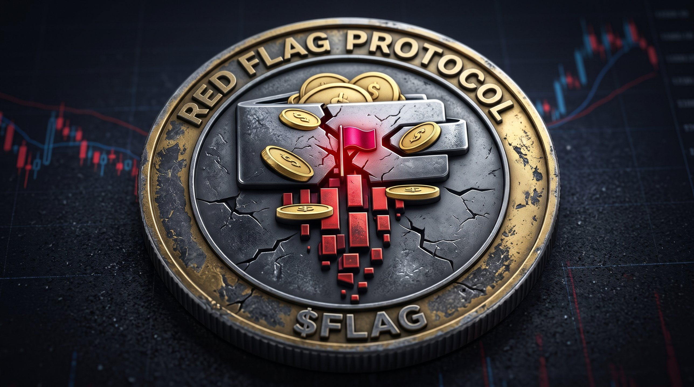

# 12 Red Flags

**Play it: [12redflags.com](https://12redflags.com)**

A fake crypto project built to look like the scams that took billions in 2025. Twelve red flags are hidden on the page, along with four decoys that look suspicious but are actually fine. Find all twelve without tripping the decoys.

This is a free training tool from [Crypto Clarity Collective](https://cryptoclaritycollective.com), built as the companion to my book *The $6 Billion Mistake*.

## Why this repo exists

One of the twelve red flags is "no real development activity." Scam projects link to a GitHub repo with one commit, forked from someone else's token, untouched for two years.

This repo is the opposite on purpose. Everything here is built in public, with the full commit history, including the mistakes and the fixes. Look at the history and you'll see what a real project looks like over time.

## What's in here

| Folder | What it is |
|---|---|
| `site/` | The game. One self-contained HTML file, no build step, no tracking pixels. |
| `n8n/` | The automations behind it, as n8n workflow exports. |
| `assets/` | The Red Flag Protocol artwork. `flag-icon-1000.png` (big flag) is for small sizes: token icon, favicon, app icons. `flag-icon-1000-classic.png` and `flag-logo.jpg` (smaller flag) are for anywhere the art shows large. |

### site/index.html

Everything is in one file. The settings live in the `CONFIG` block near the top: contract address, fee recipient, newsletter link, and the score webhook. While the contract address is empty, the page says no token exists yet, so anything claiming to be $FLAG before launch is fake.

The scam claims on the page are fake on purpose. Every card carries a "TRAINING SITE" watermark, and a notice bar stays pinned to the bottom of the screen, so screenshots stay labeled.

### n8n/

- **spot-the-flag-score-logger.json** receives each finished game, checks it, and appends one row to a Google Sheet. It records the score, flags found, false alarms, time, and which flags were missed. No names, emails or IP addresses are stored. Scores that don't add up (12 flags found but some still marked missed, impossible point totals) are dropped.
- **spot-the-flag-weekly-summary.json** reads the sheet every Monday morning and emails a summary: games played, average flags found, and the three most-missed flags.

To use them in your own n8n: import each file, attach your own Google Sheets and Gmail credentials, and replace `YOUR_GOOGLE_SHEET_ID` and `you@example.com`. The sheet needs a tab called `Plays` with these headers in row 1: `Received`, `Score`, `Flags found`, `False alarms`, `Seconds`, `Missed flags`, `Client time`.

## About $FLAG

Red Flag Protocol ($FLAG) is a planned token on Base, built to pass my own scanner and launched in public as a teaching tool.

- **Do not buy it.** It is not an investment. Expect it to go to zero.
- I hold no team allocation and will never earn a cent from it. Creator fees go to a published charity address.
- No token exists yet. The official contract address will be posted at [12redflags.com](https://12redflags.com) and in this README at launch. If it isn't that exact address, it's a scam.

## Not financial advice

Nothing here is an offer to sell anything. It's a training tool. Check everything yourself, including this repo.
